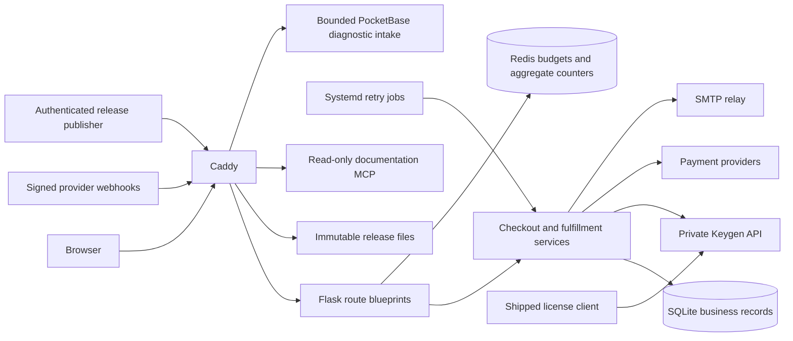

# Architecture and security review — 2026-11-06

This review uses the working tree, including existing checkout/contract/withdrawal edits. Changes preserve those edits. It covers the maintained server, license client, read-only MCP service, deployment definitions, diagnostic hooks, documentation, and promo tooling. Ignored local checkouts and the downloaded `index.html` are outside deletion scope.

## Architecture and trust boundaries

Flask blueprints own HTTP validation and responses; services own provider operations and fulfillment; SQLAlchemy/Alembic own durable payment and delivery state. Durable receipts acknowledge verified payment events before external fulfillment. Leases and stable Keygen issuance IDs make retries possible. SMTP delivery remains at least once: process death after SMTP acceptance may cause a duplicate email, with the same Message-ID.

The proxy must remain the only public entrance to Gunicorn. Checkout geolocation consumes the proxy-provided address transiently, then removes addresses before Flask. No address-based application budgets or new personal-data logs were introduced. Keygen has a separate Postgres/Redis deployment and private application credentials. Its public API is separately proxied. MCP is a separate stateless process with bounded bodies and DNS rebinding protection. Promo is build tooling, not the payment server runtime.

## Findings and changes

| Priority | Evidence / finding | Resolution |
| --- | --- | --- |
| High | Keygen identity, policy, scheme and renewal checks used Python `assert`, disabled by `-O`. | Explicit exceptions now fail closed under optimization; malformed response tests run under `-O`. |
| High | HTTP `/killswitch` could invoke host `poweroff`; it also accepted query credentials and bypassed rate limits. | Route, subprocess helper and token config removed. Shutdown is an operator SSH/system administration action. Proxy denial rules remain as defense in depth. |
| High | Container maintained a separate package list, omitting TUF and curl-cffi; deployment excluded `uv.lock`. | Container and server/MCP deployment install committed locks; separate MCP lock added. |
| Medium | Default Flask host acceptance and forwarded host/prefix trust widened the routing boundary. | Explicit allowed hosts, rejection before Flask hooks, forwarded host/prefix ignored. Scheme still trusts one local proxy hop. |
| Medium | CI authentication accepted query tokens; non-ASCII credentials could raise during comparison. | Header-only credentials; byte comparison handles malformed Unicode safely. |
| Medium | Script CSP permitted arbitrary inline scripts and Tailwind CDN execution. | Local script policy plus nonces for checklist and structured metadata. Existing CSS was already local: no Tailwind runtime/build replacement was necessary. Inline style permission remains for existing templates. |
| Medium | Statistics wrote SQL twice per request using the business session, potentially committing unrelated pending work and creating write contention. | Separate Redis aggregate store; thread-safe process-local development store. Streamed responses are not consumed for byte counting. Historical SQL counters remain untouched. |
| Medium | Rate limiter derived keys from addresses that middleware deliberately removed. | Explicit shared endpoint budget, additional signed-browser budget on crypto creation, bounded checklist login attempts, and production Redis preflight requirement. Existing order/provider refresh throttles and signature replay limits remain. |
| Medium | Promo audit reported 10 high and 10 moderate affected packages, including inherited advisories. | Remotion/React/tooling updated; patched minimatch override resolves the remaining advisory. Final npm audit reports zero. |
| Maintenance | Unused imports and assignments obscured real dependencies. | Removed confirmed unused imports and local assignments, retaining calls with side effects. Removed obsolete HTTP administration code. No speculative route, migration or template deletions. |
| Maintenance | Live Keygen tests discovered credentials automatically and could mutate a reachable instance during ordinary test discovery. | Require explicit `RUN_LIVE_KEYGEN_TESTS=1`. |

The [minimatch advisory](https://github.com/advisories/GHSA-g3hv-75wg-m249) identifies a pattern amplification denial of service fixed in 11.0.1. The override selects patched 11.x; lint and build pass. Keep the override until upstream tooling resolves to a patched version. TypeScript stays on 5.9.3 because the latest compiler failed inside the ESLint parser's `ts-api-utils` integration. This is a tested compatibility exception, not an unreviewed forced upgrade.

## Verification and maintenance

- Server: 311 tests, one explicitly gated live integration class skipped. Includes migration upgrades/downgrades, payment receipt retry/replay and expired lease recovery, malformed signatures, access control and provider failures.
- New regressions: hostile hosts, forged forwarded host/prefix, CI query rejection and Unicode credentials, CSP nonces, no SQL telemetry commits, concurrent statistics, Redis failure isolation, concurrent issuance identity reuse, malformed Keygen responses.
- Eight hardening regressions also pass under Python optimization. A local Chromium smoke test passes age confirmation, CSRF-protected method selection, country/withdrawal consent, encrypted delivery email and simulated payment creation under the stricter CSP; external requests are blocked.
- MCP: six catalog/protocol tests pass in its separate dependency environment.
- Python runtime environments and exported locked requirements: pip-audit reports no known vulnerabilities. Promo npm audit: zero vulnerabilities. Advisory databases are time-dependent and cannot establish absence of all vulnerabilities.
- Promo: lint/type check, bundle and representative PNG render pass.
- Deployment rollback tests pass in the server suite; dashboard privacy migration tests pass (three executed, one candidate importer check skipped). PocketBase integration skipped because its binary is absent.
- Ruff checks undefined names, unused imports/variables and syntax failures. Bandit source scan found XML escaping false positives, a badge status named `unknown` mistaken for a secret, and an internal non-security assertion; Keygen security assertions were fixed. Vulture found no confidently unused application functions; framework callbacks and SQLAlchemy event parameters are externally invoked.
- GitHub Actions runs tests, lint, locked dependency audits and promo checks on pushes, PRs and weekly schedules. Developer tools are isolated in the `dev` dependency group.

## Rollout and remaining limits

1. Back up SQLite and deployment configuration; keep matching code/database rollback material. No schema changes are required by this hardening pass.
2. Configure shared Redis via `RATELIMIT_STORAGE_URI`, verify its availability and persistence policy, and run deployment preflight. Statistics use a fixed-size Redis hash; persistence belongs to Redis configuration, not synchronous SQLite snapshots. Redis outages omit telemetry; payment state remains independent. Existing SQL statistics are retained for historical reference and are no longer incremented.
3. Add staging hostnames using `ADDITIONAL_TRUSTED_HOSTS`. Keep Gunicorn bound behind the proxy; direct container port exposure would violate the trusted-scheme/geolocation boundary.
4. Migrate CI callers to `X-CI-TOKEN`. Remove `KILL_TOKEN` from deployed secrets. Use the host operator's shutdown command when needed.
5. Verify proxy configuration, real Redis counters, staging checkout, signed release publication and Keygen policy against the deployed environment before production cutover. Deploy the reviewed candidate through the existing backup/rollback workflow.

No Docker/Podman, Redis server or production Caddy configuration is available here, so full image startup, real Redis persistence/failover and live proxy validation are not certified. External Keygen/Postgres/Redis images are digest-pinned; their running OS/Ruby dependency inventories require image scanning in a container-enabled environment. This pass does not claim to update or audit every package inside those external images. Do not edit the image's Gemfile independently of its bundled lock/dependencies.

Existing legacy browser scripts still reference older age-entry labels and checkout selectors; the new focused security browser smoke exercises the current checkout with external network traffic blocked. They should be consolidated into current maintained scenarios rather than counted as passing coverage.

Delivery services still duplicate lease/retry patterns across Patreon, crypto, card checkout and withdrawals. Their retention, provider identities and failure rules differ; replacing all of them with a generic job framework would need a separate state migration and failure-injection review. Existing durable receipts and idempotent issuance are retained. Financial amount, country evidence, contract text and retention semantics are not rewritten merely to reduce line counts.

Global no-IP budgets inherently allow one browser to exhaust a shared allowance; browser cookies can also be reset. Monitor aggregate 429 counts and tune admission at the edge without adding IP retention. Capacity/load tests against the deployed SQLite/storage environment remain necessary before increasing worker counts.

## Patreon membership retirement

The membership webhook endpoint, payload parser, tier configuration, membership delivery model/service, benefit confirmation generator and retry hook have been removed. Patreon Shop email activation, sales scraping, order deduplication and delivery remain in `patreon_shop.py`. Existing membership delivery rows remain as an unmapped historical table; Alembic ignores that specific table during autogeneration so removal of the model cannot silently delete records. No database upgrade is required for retirement. Retired webhook calls return 404. Remove the old webhook subscription and secrets in the operator dashboard/configuration.

Retirement validation: 296 server tests pass (one live integration class skipped), including 15 Shop tests, retired route rejection, historical record preservation and a clean Alembic schema check. The schema check exposed a pre-existing missing `ix_payment_receipts_due` model declaration; metadata now matches the existing migration. Shop outage fallback behavior is unchanged by membership removal.
