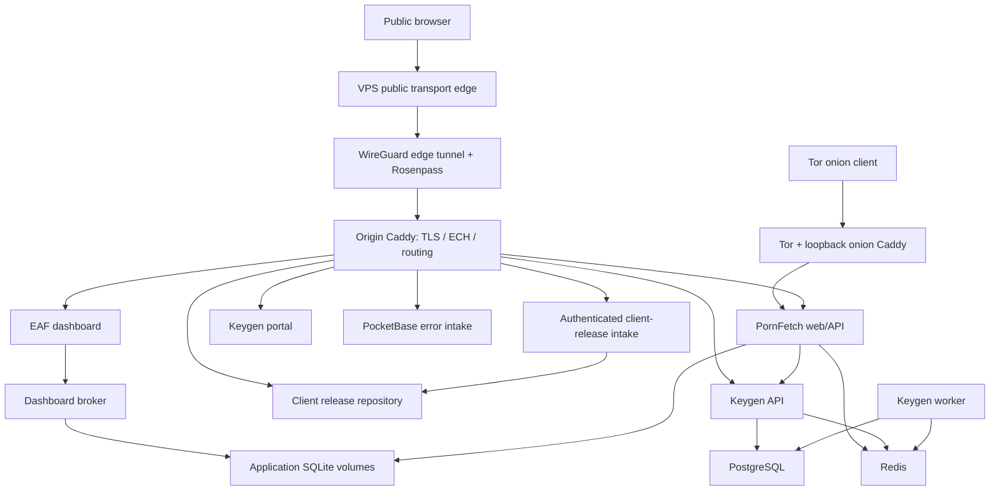

# PornFetch operator guide

Start here. `/srv/infra` is the authoritative infrastructure repository. Its code is
installed separately: editing this checkout does not immediately alter the server.
Application source remains in `/home/asuna/analysis/`; application data does not.

## Everyday commands

Run these from any directory:

```sh
sudo pfctl status
sudo pfctl doctor
sudo pfctl logs web
sudo pfctl logs dashboard
sudo pfctl stop app
sudo pfctl start app
sudo pfctl restart web
sudo pfctl backup
sudo pfctl backup-status
sudo pfctl snapshots
sudo pfctl verify-restore
```

`app` means all application services, database/setup jobs, the dashboard broker,
metrics timer, and client-release intake. Stop runs in reverse dependency order.
It leaves SSH, tunnels, Tor and Caddy running; Caddy will show upstream failures.
For a full application maintenance window, use:

```sh
sudo pfctl maintenance stop
sudo pfctl maintenance start
```

Maintenance also stops/starts the two Caddy services. It leaves management
networking available. `start app` explicitly starts every configured component;
it is not a restoration of an earlier selectively stopped state.

Component names: `web`, `dashboard`, `broker`, `postgres`, `redis`, `keygen-setup`,
`keygen-api`, `worker`, `portal`, `pocketbase`, `migrate`, `releases`, `metrics`.
`pfctl logs metrics` follows the timer journal; its job output is available with
`journalctl --user -u eaf-dashboard-metrics.service` as the service account.

## Updating an application

Use an exact reviewed commit or tag. `HEAD` deploys the current local commit;
`origin/main` deploys the fetched branch tip if that is the repository's branch.
The tool fetches but never edits or resets your working checkout.

```sh
sudo pfctl deploy web --ref HEAD
sudo pfctl deploy dashboard --ref HEAD
sudo pfctl status
```

Deployment requires a clean source tree and working Git authentication for the
source owner. It exports an immutable tree, builds rootlessly, runs tests in the
candidate dependency environment, loads the digest-pinned image, takes a
coordinated backup, reruns the web migration when applicable, and checks health.
The source checkout is never mounted into production containers.

Build definitions and dependency constraints are in `/srv/infra/ops/`.
Dependency/base-image changes are explicit maintenance work: update the reviewed
constraints and Containerfiles, install them, then deploy. Do not remove version
constraints to work around an unexplained installation failure.

A deployment failure after database work leaves the affected service stopped.
It restores the previous service definition but does not run old code against
an unknown schema. Recover with:

```sh
sudo pfctl rollback web
# or:
sudo pfctl rollback dashboard
```

Rollback restores the affected application's data volume from its coordinated
pre-deployment backup, restores its previous definitions, starts the stack, and
checks health. It stops the full application while restoring. Changes since that
backup in the affected volume are rolled back; the failed data is preserved under
`/var/lib/pornfetch-ops/failed-data/`. PostgreSQL/Redis are not migrated by these
application deployment commands and are not rewound by this rollback.

`deploy-server` is a compatibility entry point for `pfctl deploy web`; the old
branch/skip/force flags no longer apply. Use `deploy-server --ref <ref>`.
The `releases` service instead receives client installer/CLI/download releases;
it does not deploy the web application. Its endpoints remain unchanged.

## Where everything lives

| What | Source / configuration | Installed state |
|---|---|---|
| Operator tools | `/srv/infra/ops/` | `/usr/local/lib/pornfetch-ops/`, `/usr/local/sbin/pfctl` |
| Operator settings | Example in `ops/ops.example.json` | `/etc/pornfetch/ops.json` |
| Containers/network/volumes | `msi/podman/application/` | `/var/lib/pornfetch/.config/containers/systemd/` |
| Extra user services | `ops/user-systemd/` | `/var/lib/pornfetch/.config/systemd/user/` |
| Application secrets | Never in Git | `.../containers/systemd/credentials/*.cred` |
| Application data | Never in Git | `/var/lib/pornfetch/.local/share/containers/storage/volumes/*/_data` |
| Caddy configuration | `msi/caddy/` | `/etc/caddy/Caddyfile`, `onion.Caddyfile`, generated `caddy.json` |
| Caddy certificates/ECH/ACME | Never in Git | `/var/lib/caddy/` |
| WireGuard/Rosenpass | Public templates in `msi/` and `vps/` | `/etc/wireguard/`, `/etc/rosenpass/` |
| Firewall | `msi/nftables/` | `/etc/nftables.conf` |
| Onion identity | Never in Git | `/var/lib/tor/pornfetch-onion/` |
| Client release files | Published by `releases` intake | `/srv/pornfetch-repo/` (`/srv/repo` is an alias) |
| Encrypted backups | Never in Git | `/var/backups/pornfetch/restic/` |
| Backup password | Never in Git or logs | `/etc/pornfetch/backup-password` |
| Release/recovery records | Never in Git | `/var/lib/pornfetch-ops/` |
| Rootless build cache | Disposable after checking references | `/var/lib/pornfetch-build/` |

`...` in the application-secret row expands to `/var/lib/pornfetch/.config`.
Non-secret application settings currently live as `Environment=` entries in the
Quadlets. The settings example configures paths, not application passwords.

## How Podman works here

An **image** packages application code, Python/Node/Ruby and libraries. A
**container** is an instance of that image, running as isolated processes. It is
not a full virtual machine and shares the host's Linux kernel.

A **volume** keeps data outside that disposable container. Recreating the web
container does not discard `server.db`. Deleting a volume can discard data.
A **bind mount** exposes a particular host file/directory, such as a hook or
GeoIP database, inside the container. The private **network** lets the containers
reach each other by name without publishing PostgreSQL or Redis to the host.

The **Containerfile** says how to build an image. The **Quadlet** (`.container`,
`.network`, `.volume`) says how to run it. Podman's generator turns Quadlets into
systemd units when the user manager reloads. **systemd** starts them on boot,
orders dependencies, supervises failures, and collects logs.

**Rootless** means these containers belong to Linux account `pornfetch` (home
`/var/lib/pornfetch`). Container UID 1000 can map to a large subordinate UID on the
host; do not recursively chown application data to `asuna`. Root has a separate
Podman store, so `sudo podman ps` is not the production container list. The build
store also differs from the runtime store. Lingering keeps the service account's
systemd manager running without an interactive login.

```sh
# Underlying read-only commands; pfctl handles this account context for you.
sudo -Hu pornfetch sh -c 'cd / && XDG_RUNTIME_DIR=/run/user/$(id -u) podman ps'
sudo -Hu pornfetch sh -c 'cd / && XDG_RUNTIME_DIR=/run/user/$(id -u) podman volume ls'
sudo -Hu pornfetch sh -c 'cd / && XDG_RUNTIME_DIR=/run/user/$(id -u) systemctl --user status pornfetch-web.service'
sudo -Hu pornfetch sh -c 'cd / && XDG_RUNTIME_DIR=/run/user/$(id -u) journalctl --user -u pornfetch-web.service -n 80'
```

Use systemd/`pfctl` to stop supervised services. Direct `podman stop` can conflict
with systemd's desired state. A Git pull changes source only; `podman pull` obtains
an image only. Deployment selects and activates a particular built image.

A migration/setup unit showing `active (exited)` is a completed one-time job,
not a web server. A bare `systemctl start` does not necessarily rerun it; web
deployment explicitly restarts its migration unit.

Podman/Quadlet is retained because systemd supervision, credential delivery and
volume ownership are already integrated. Compose would group service definitions
more compactly, but migrating would require rebuilding those integrations.

### Request and service map



The VPS portion follows checked-in architecture. A noninteractive SSH check did
not complete during this implementation, so remote service state is unverified.
As `asuna`, use `ssh privex` through the existing TPM SSH agent to inspect it;
avoid changing edge routing until an independent management session is available.
Local checks alone do not prove current remote edge/DNS state. Management WireGuard is a separate access path.
See [recovery](RECOVERY.md) before changing networking.

## Installing reviewed infrastructure changes

```sh
sudo python3 /srv/infra/ops/install.py
sudo pfctl doctor
```

The installer waits for deployments and other maintenance to finish. It copies tools and application definitions into their installed
locations and reloads systemd. It preserves managed release image selections.
It does not start/restart applications, enable backup timers, alter credentials,
or apply Caddy/network configuration. Restart affected application services
explicitly after reviewing drift.

For Caddy, its JSON is generated from the Caddyfile by existing host helpers;
validate/render with those helpers before a controlled reload. Never edit the
JSON alone. Host networking, firewall, SSH, and database engine upgrades retain
separate maintenance procedures because they can affect access or persistent data.

`pfctl verify-restore` restores the latest snapshot into a private temporary directory,
runs isolated recovery checks, and deletes that temporary plaintext on success.
The same check runs weekly; encrypted snapshot retention runs daily.

`pfctl doctor` checks managed file drift, credential file availability/permissions,
failed user units, backup freshness, and web/dashboard health. It does not prove
that every external payment, DNS, or network integration works.

The [cleanup inventory](CLEANUP.md) identifies archived duplicates. Historical
reports explain prior decisions; they are not installation instructions.
